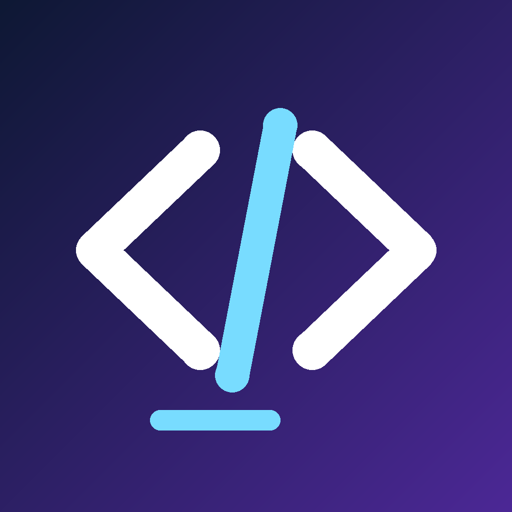

<p align="center">
  
</p>

<h1 align="center">CodeLab</h1>

<p align="center">
  Um ambiente de programação para iPhone: escreva código, rode no aparelho, compile na nuvem e publique no GitHub.
</p>

---

## Visão geral

O iOS não permite compilar programas dentro do próprio aparelho. O CodeLab resolve isso combinando três coisas:

1. **Um editor completo** no iPhone, com cores de sintaxe, corretor de erros e navegador de arquivos.
2. **Execução local** de C/C++ e Java, sem precisar de internet.
3. **O GitHub como servidor de build**: o app envia o projeto e o GitHub Actions compila Android (APK), iOS (IPA) e Godot, devolvendo o resultado.

Feito para funcionar bem em telas pequenas, a partir do iPhone 6s com iOS 15.

## Diferenciais

- **Compila Android e iOS sem computador.** O CodeLab envia o projeto, o GitHub Actions monta o APK ou o IPA e o app baixa o resultado de volta. Em seguida, o botão **Instalar / compartilhar** abre o arquivo direto no TrollStore, em Arquivos ou por AirDrop.
- **Roda C/C++ e Java no próprio aparelho, offline.** Com variáveis globais, arrays (inclusive 2D), `switch`, `do-while`, `for-each`, strings, funções matemáticas e **entrada de dados** (`cin`, `Scanner`) por uma caixa de entrada. Sem servidor, sem conta e sem espera.
- **Verificar projeto antes de enviar.** Checa localmente o manifesto, o Gradle, o `project.yml`, o `project.godot`, o workflow e os arquivos de código, para você não gastar um build à toa.
- **Seus repositórios dentro do app, só com o que importa para quem programa.** Cartões laterais no Perfil, navegação pelo código, exclusão de arquivos e pastas do repositório (em um commit), execuções do Actions e **artefatos gerados** prontos para baixar e instalar. O CodeLab não tenta ser o app do GitHub: não tem issues, pull requests nem rede social, só a parte de quem constrói.
- **Baixar do GitHub para o aparelho** em um toque: o projeto vem em um .zip só, vai para a pasta certa e já fica ligado ao repositório para `git commit` e `git push`.
- **Da .zip ao APK/IPA em um toque.** A aba **Build** envia o .zip em um único commit, dispara o build, mostra cada etapa ao vivo e baixa o resultado para o aparelho.
- **Navegador de arquivos com dois modos.** Ícones, como no app Arquivos do iOS, ou árvore, como no Android Studio, com menu de contexto completo.
- **Busca em todo o projeto** e **exportação em .zip** para backup ou envio.
- **Modelos prontos** (FizzBuzz, números primos, Fibonacci…) que rodam na hora, para começar a praticar.
- **Login oficial do GitHub** dentro do app, com verificação em 2 etapas.
- **Interface pensada para tela pequena.** A barra inferior encolhe ou some enquanto você programa.
- **Tudo em um só lugar:** editor, terminal com git, perfil e build na nuvem.

## Recursos

### Editor
- Realce de sintaxe para C/C++, Java, Kotlin, GDScript, Swift, Gradle, YAML e outros.
- Corretor que aponta chaves e parênteses sem par, `;` ou `:` faltando, com botão **Corrigir**.
- Tamanho da fonte ajustável.
- **Digitação assistida**: fecha parênteses, colchetes, chaves e aspas sozinho; mantém a indentação ao dar Enter; abre o bloco entre `{ }`; recua o `}` automaticamente; apaga pares vazios de uma vez.
- **Barra acima do teclado** com desfazer, refazer, setas para mover o cursor, Tab e Shift+Tab (também em várias linhas), comentar/descomentar, duplicar, apagar e mover linhas, além dos símbolos de programação.
- **Abas de arquivos abertos** para alternar rápido entre arquivos.
- **Ir direto ao erro**: tocar em um problema do corretor ou em um resultado da busca leva o cursor para a linha.
- **Posição do cursor** (linha e coluna) e **salvamento automático** com indicador.
- Salvamento ao trocar de arquivo ou sair.
- Busca em todos os arquivos do projeto e exportação do projeto em .zip.

### Arquivos
- Dois modos de navegação, alternados por um botão:
  - **Ícones**, no estilo do app Arquivos do iOS.
  - **Árvore**, no estilo do Android Studio.
- Segure em qualquer item para abrir as opções: abrir, renomear, duplicar, apagar, novo arquivo ou pasta.

### Projetos
| Tipo | Como roda |
|---|---|
| **C / C++** | No aparelho, pelo interpretador integrado |
| **Java** | No aparelho, pelo interpretador integrado |
| **Android** | Projeto vazio em Java ou Kotlin, com escolha da versão mínima do Android; o APK é gerado no GitHub Actions |
| **iOS** | Projeto vazio em SwiftUI; o IPA é gerado no GitHub Actions |
| **Godot** | Projeto com `project.godot` e script; validado no GitHub Actions |

### GitHub
- **Login oficial**: a página do GitHub abre dentro do app, com email, senha e verificação em 2 etapas.
- Envio do projeto (add, commit e push) direto do app.
- **Aba Build**: escolha um .zip e o repositório numa lista com **busca e favoritos (★)**; a conta é a que você já conectou e a branch é a `main`, com um menu para trocar quando o repositório tem outras. O CodeLab envia tudo em **um único commit** (no estilo do ZipToGit), dispara o workflow, mostra as **etapas ao vivo** (abrir, enviar, iniciar, compilar, baixar) com o tempo decorrido e entrega o APK ou IPA pronto para instalar ou compartilhar. Mantém um histórico dos últimos builds.
- **Perfil** com foto, nome e números da conta, **repositórios em cartões laterais** (favoritos primeiro) e atalho para abrir a pasta do CodeLab no app Arquivos.
- **Abrir um repositório**: branch atual com menu para trocar, **Código** (pastas e arquivos; deslize ou segure para **apagar do repositório**, em um único commit), **Actions** (execuções, executar de novo, excluir) e **Artefatos** (baixar o .ipa/.apk, compartilhar ou excluir).
- **Baixar para o aparelho**: tanto pelo repositório quanto pelo cartão "Baixar do GitHub" na tela inicial. Pelo terminal também: `git clone usuario/repositorio`.
- Execução do workflow e leitura do resultado dentro do app.

### Terminal
- **Digitação no próprio terminal**: você escreve o comando direto na última linha, como num terminal de verdade. Quando há sugestão (comando, subcomando do `git`, pasta ou arquivo, ou correção de um erro de digitação), o texto fica **sublinhado de amarelo** e uma **lâmpada** aparece no canto; tocando no texto ou na lâmpada, abre uma janelinha pendurada com as opções. A tecla **Tab** completa a primeira. Com o campo vazio, nada aparece.
- Saída com cores (erros em vermelho, sucessos em verde, comandos em destaque), histórico salvo entre as sessões, ↑ ↓ para repetir comandos e atalhos `/ ~ - . | >` acima do teclado.
- Menu para copiar toda a saída ou limpar a tela.
- Comandos de arquivo (`ls`, `cd`, `cat`, `cp`, `mv`, `rm`, `mkdir`…).
- `git` integrado ao GitHub: `clone`, `status`, `add`, `commit`, `push`, `pull`, `log`.
- Terminal real (`ios_system`) para `sed`, `awk`, `tar`, `curl`, `find`, `sort` e outros utilitários.

### Interface
- Barra inferior com **Projetos**, **Build**, **Terminal** e **Perfil**: escura, e só desfoca quando algo passa por trás; o conteúdo sobe junto, sem ficar escondido atrás dela. A aba muda assim que o dedo encosta.
- **Animações fluidas** (opcional): transições com mola, resposta ao toque nos botões e uma **gota de vidro** azul na barra: translúcida, com brilho e relevo, que desfoca só as bordas do que passa por baixo e deixa o ícone nítido no centro. Cada efeito liga e desliga em **Configurações**: animações fluidas, desfoque ao trocar de aba, gota de vidro (3D) e elasticidade.
- Ao editar código, a barra encolhe para uma faixa fina, ou some, conforme a configuração.
- Desfoque da barra, ocultar ao programar e tamanho da fonte em **Perfil → Configurações**.

## Instalação

O CodeLab é compilado pelo próprio GitHub Actions, sem Mac.

1. Envie este repositório ao seu GitHub, com todos os arquivos, inclusive a pasta `.github`.
2. Na aba **Actions**, aguarde o workflow **Build IPA** terminar (ele roda a cada commit na `main`).
3. Baixe o artifact **CodeLab-ipa**, extraia o `.zip` e abra o `.ipa` no **TrollStore**.

Identificador do app: `com.code.lab`. Requer iOS 15 ou superior.

## Configurar o login com GitHub

Uma vez só:

1. No GitHub, abra **Settings → Developer settings → OAuth Apps → New OAuth App**.
2. Use qualquer nome. Em Homepage e Callback, coloque `https://github.com`.
3. Marque **Enable Device Flow** e salve.
4. Copie o **Client ID** e cole no app, em **Perfil → Entrar com GitHub**.

Depois disso, basta tocar em **Entrar com GitHub** e fazer o login normalmente na página que abre.

## Limites conhecidos

- **Execução local** (C/C++ e Java): suporta variáveis (inclusive globais), arrays, `if`, `while`, `do-while`, `for`, `for-each`, `switch`, funções, recursão, `printf`, `cout`, `System.out`, `cin` e `Scanner`. Ainda não há ponteiros, classes com objetos, templates nem a STL (`vector`, `map`…).
- **Terminal**: não existe `gcc`, `javac` nem Python. O iOS não permite executar compiladores nativos; para isso use o botão de executar ou o GitHub Actions.
- **Importar .zip**: arquivos de até 95 MB; a permissão de execução de scripts (`.sh`) não é preservada.
- O GitHub Actions usa os minutos gratuitos da sua conta.

## Estrutura

```
CodeLab/
├── CodeLabApp.swift     ponto de entrada
├── Dock.swift           barra inferior, início, perfil e configurações
├── IDE.swift            editor de código e navegador de arquivos
├── CodeEditor.swift     editor com realce de sintaxe
├── Linter.swift         corretor de erros
├── Interp.swift         interpretador de C/C++ e Java
├── Extras.swift         busca, exportar .zip e compartilhar
├── Terminal.swift       comandos e catálogo do terminal
├── TerminalText.swift   terminal digitável, sugestões e lâmpada
├── RealShell.swift      ponte com o ios_system
├── GitHub.swift         API do GitHub, login e envio
├── GitHubRepo.swift     ver repositório, apagar arquivos, Actions, artefatos e baixar
├── RepoViews.swift      telas do repositório (cartões, código, Actions, artefatos)
├── GitEngine.swift      git sobre a API do GitHub
├── GitHubWeb.swift      página de login do GitHub dentro do app
├── ZipToGit.swift       aba Build: .zip, etapas ao vivo e resultado
├── Importer.swift       abrir projetos e .zip locais
├── Models.swift         linguagens e armazenamento
├── Templates.swift      projetos iniciais e workflows
└── Views.swift          telas de projetos e login
```

## Créditos

- [`ios_system`](https://github.com/holzschu/ios_system), de Nicolas Holzschuch, é a base do terminal real.
